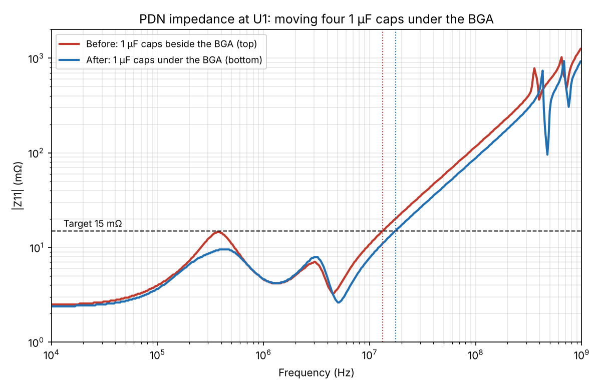

# PCB Power Integrity (PDN) Analysis

Design and simulation of the power delivery network for a 1.0 V / 2 A rail feeding an 81-ball BGA on a 4-layer board, using **Altium Designer** and **Ansys SIwave 2025 R1**, cross-checked with a lumped RLC model in Python.

> All results are from simulation. No board was built or measured.

**Full report:** [docs/PDN_Analysis_Report.pdf](docs/PDN_Analysis_Report.pdf) (23 pages)

## Results

| Check | Budget | Result | Status |
|---|---|---|---|
| DC IR drop, J3 to U1 | 20 mV (2% of 1.0 V) | 5.2 mV (0.5%) | Pass |
| PDN impedance, 10 kHz to 10 MHz | 15 mOhm | 14 mOhm worst case | Pass |
| 15 mOhm crossing, 1 uF caps beside BGA | n/a | 13.3 MHz | Baseline |
| 15 mOhm crossing, 1 uF caps under BGA | n/a | 17.7 MHz | ~25% lower loop inductance |

Target impedance: Z = 30 mV ripple / 2 A transient = **15 mOhm** (from a 5% tolerance split into 20 mV DC and 30 mV AC).



## What was done

1. **Board and PDN design (Altium).** 4-layer stackup (Top / GND / PWR / Bottom), a custom 9 x 9 BGA at 1.0 mm pitch with alternating GND and VDD rows, via-in-pad on every ball, 2 x 100 uF bulk capacitors at the connector and 8 x 0402 local capacitors at the BGA.
2. **DC IR drop (SIwave).** 1.0 V source at J3, 36 current sources at U1 (55.6 mA each, 2 A total). The result was checked by hand from the copper sheet resistance (~0.5 mOhm per square for 1 oz copper).
3. **PDN impedance (SIwave SYZ, 10 kHz to 1 GHz).** Seven single-variable runs took the worst case from ~1 Ohm to 14 mOhm:
   - fixed an imported capacitor-model error (bulk capacitor read in as 1 nF);
   - spread capacitor values across decades (10 uF + 1 uF) to avoid anti-resonance gaps;
   - added ESR damping, which cut the main peak about 40x.
4. **Model cross-check.** A lumped RLC model (`model/`) reproduces the SIwave peaks and dips.
5. **Placement experiment.** Four 1 uF capacitors were moved to the bottom side under the BGA, each bridging a VDD ball and the GND ball next to it, with its pads on the BGA's own vias. This extended the 15 mOhm band from 13.3 to 17.7 MHz with no extra capacitors.

## Key findings

- **Capacitance only helps where the chip can see it.** Bulk capacitors 90 mm away are hidden behind ~3 nH of plane inductance.
- **Damping matters as much as capacitance.** Without ESR, the capacitor network rang to 0.3 Ohm.
- **Above ~15 MHz, inductance rules.** Mounting and plane inductance set the impedance there, not capacitor value. Placement under the BGA reduces it.
- **The board's job ends where the package takes over.** The board only has to meet the target up to the chip vendor's effective frequency. This test chip has no package model, so 10 MHz is an assumption.

## Repository layout

```
.
├── README.md
├── docs/        Full report: PDN_Analysis_Report.pdf
├── images/      Figures used in the report (fig01 to fig19)
├── model/       Lumped RLC PDN model (Python)
├── altium/
│   ├── original_placement/   Altium project, schematic, PCB, libraries, ODB++ export
│   └── under_bga/            PCB with the 1 uF capacitors moved under the BGA
└── siwave/      Ansys SIwave projects (results not included)
```

## Figures

| Figure | Content |
|---|---|
| fig01 to fig05 | Altium: stackup, BGA footprint, schematic, placement, via-in-pad |
| fig06 to fig07 | SIwave: stackup and PWR plane |
| fig08 to fig11 | DC IR drop: power per layer, voltage on PWR and GND, current density |
| fig12 to fig17 | PDN impedance runs, first design to final design |
| fig18 to fig19 | Capacitors moved under the BGA: before/after and SIwave result |

## Limitations

- Simulation only; capacitor models are ideal R-L-C, not vendor S-parameters.
- No package or die model, so the 10 MHz board-level limit is assumed.
- The regulator is modelled as a 0.47 nH inductor across J3 in the AC runs.
- The low-frequency peak (0.4 MHz) also dropped in the under-BGA run (14.6 to 9.5 mOhm). Placement does not explain this; it likely comes from a difference between the two ODB++ imports. The high-frequency result is not affected.

## Tools

Altium Designer · Ansys SIwave 2025 R1 · Python (NumPy, Matplotlib)

## Author

R Dharma Teja, M.Tech (Integrated Circuits and Microsystem Packaging), IIT Hyderabad
